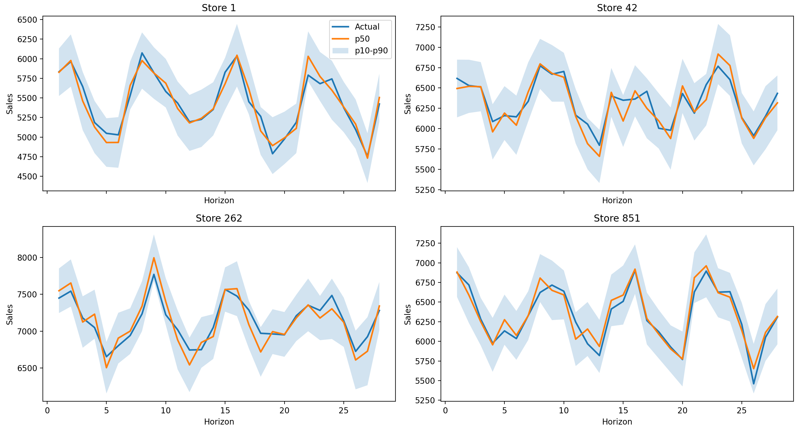

# Continual Retail Inventory Optimization

Demand forecasting and automated stock replenishment for retail stores, built on the
[Rossmann Store Sales](https://www.kaggle.com/c/rossmann-store-sales) dataset.

A forecaster predicts how much each store will sell over the next days, a reinforcement-learning
agent turns that forecast into daily order decisions, and a continual-learning layer keeps the
forecaster accurate as new stores are added. Everything is served through a FastAPI backend and a
React dashboard.



---

## How it works

| Component | What it does | Built with |
|-----------|--------------|------------|
| **Forecasting** | Temporal Fusion Transformer producing 28-day demand forecasts with uncertainty bands (quantiles p2–p98) | PyTorch, PyTorch Lightning, pytorch-forecasting |
| **Continual learning** | Adapts the forecaster to new groups of stores without forgetting earlier ones (Naive, EWC, Replay, optional PackNet pruning) | Avalanche |
| **Inventory control** | PPO agent that decides daily order quantities from current stock and a 7-day demand forecast, in a simulated store with a 2-day supplier lead time and holding, ordering and lost-sales costs | Stable-Baselines3, Gymnasium |
| **Serving** | REST API for forecasts, order recommendations, simulations, KPIs and alerts | FastAPI |
| **Dashboard** | KPI overview, per-store forecasts, inventory simulation, continual-learning metrics | React, Vite, Tailwind, Recharts |

```
Rossmann CSVs ─▶ data pipeline ─▶ TFT forecaster ─▶ RL ordering agent ─▶ FastAPI ─▶ React dashboard
                                        ▲
                         continual learning (new stores)
```

---

## Results

**Forecasting** (TFT trained on a 50-store sample; scored on each store's final 28 open days,
which are held out of training: 1,400 store-days, July 2015)

| Forecast | sMAPE | RMSE (€/day) |
|----------|-------|--------------|
| **TFT (p50)** | **8.5 %** | **862** |
| Seasonal naive: same weekday, 4-week mean | 16.9 % | 1,654 |
| Seasonal naive: same weekday, last week | 23.5 % | 2,394 |

- The TFT halves the error of the stronger baseline (−49 % sMAPE).
- Its p10–p90 band contains the actual value on 73.6 % of days (nominal 80 %), so the uncertainty
  bands are slightly narrow.
- Reproduce with `python scripts/evaluate_tft.py` (writes `data/processed/metrics_latest.json`).

**Inventory control** (simulation, one year per store, closed days included, 15 % random error on
the agent's 7-day forecast; the agent was trained on 16 stores)

| Stores evaluated | Policy | Avg service level | Stores ≥ 95 % | Fill rate | Avg cost / store-year |
|------------------|--------|-------------------|---------------|-----------|-----------------------|
| All 1,115 Rossmann stores | Base-stock rule (95 % safety stock) | 96.5 % | 82.2 % | 98.1 % | €22,106 |
| | **PPO agent** | **99.7 %** | **99.2 %** | **99.9 %** | **€14,759** |
| 34 stores not used in training | Base-stock rule (95 % safety stock) | 96.9 % | 88.2 % | 98.1 % | €22,645 |
| | **PPO agent** | **99.8 %** | **100 %** | **100.0 %** | **€14,543** |

- Service level is the share of days without a stockout; fill rate is the share of demand served.
- Median service level across all stores is 100 %; on the 34 unseen stores a store averages 0.6
  stockout days per year.
- The 9 stores below 95 % are the largest ones (≈ 180–200 units of demand per open day), at the
  simulator's 200-unit daily order limit, so no policy can serve them fully (base-stock also drops
  to ≈ 71 % there).
- The agent stays above 98 % service level with forecast errors up to 30 %.
- These figures come from a simulator driven by historical sales (1 unit = €100 of sales), not
  from live store operations. The dashboard's KPI is a 90-day simulation for one store over 32
  demand scenarios drawn from the TFT's forecast bands (≈ 98.8 % service level).

---

## Quick start

**Prerequisites:** Python 3.9 and Node.js 20.

```bash
git clone https://github.com/ManasiNarkhede/continual-retail-inventory-optimization.git
cd continual-retail-inventory-optimization

python -m venv .venv
source .venv/bin/activate            # Windows: .venv\Scripts\activate
pip install -r requirements.txt
cd frontend && npm install && cd ..
```

**Data:** download `train.csv`, `test.csv` and `store.csv` from the
[Kaggle competition](https://www.kaggle.com/c/rossmann-store-sales/data) into `data/raw/`, then build
the reference dataset the API reads:

```bash
python -c "from src.api.model_registry import recover_tft_artifacts; recover_tft_artifacts()"
```

**Run** (two terminals):

```bash
uvicorn src.api.main:app --reload --port 8000     # API, docs at http://localhost:8000/docs
cd frontend && npm run dev                        # dashboard at http://localhost:5173
```

Trained models are included (`checkpoints/tft/`, `checkpoints/rl/`), so no training is needed to run the app.

---

## Training

```bash
python scripts/train_tft.py --config configs/tft_config.yaml \
  --override-hidden-size 64 --override-hidden-cont-size 32 \
  --override-batch-size 64 --override-max-epochs 3                # forecaster (~1.5 h on CPU)
python scripts/evaluate_tft.py                                    # held-out forecast metrics
python scripts/train_cl.py  --cl-config configs/cl_config.yaml    # continual learning
python scripts/train_rl.py  --config configs/rl_config.yaml       # ordering agent (16 stores, ~50 min on CPU)
```

Settings live in `configs/*.yaml` and are validated against `configs/schemas/`. Experiments are
tracked with MLflow (`mlflow ui --backend-store-uri mlruns/`); hyperparameter search uses Optuna
(`src/hpo/`).

---

## Project layout

```
src/
  data/      loading, validation, preprocessing, feature engineering
  models/    Temporal Fusion Transformer
  cl/        continual-learning strategies and metrics
  rl/        inventory environment, rewards, PPO/SAC agent
  eval/      metrics, baselines, backtesting, SHAP explanations
  api/       FastAPI app, model registry, routers
frontend/    React dashboard
configs/     YAML configs and JSON schemas
scripts/     training, evaluation and utility scripts
notebooks/   EDA, forecasting, continual-learning and RL notebooks
tests/       pytest suites mirroring src/
```

---

## Testing

```bash
pytest --cov=src                  # backend tests (80 % coverage gate)
ruff check src/ tests/ scripts/ && black --check src/ tests/ scripts/
cd frontend && npm run test       # frontend tests
```

GitHub Actions runs linting, the test suite with coverage and a smoke test on Python 3.9, and
builds and tests the frontend on every push.

---

## Acknowledgements

[Rossmann Store Sales](https://www.kaggle.com/c/rossmann-store-sales) (Kaggle) · PyTorch Forecasting ·
Avalanche · Stable-Baselines3 · FastAPI · MLflow · Optuna
